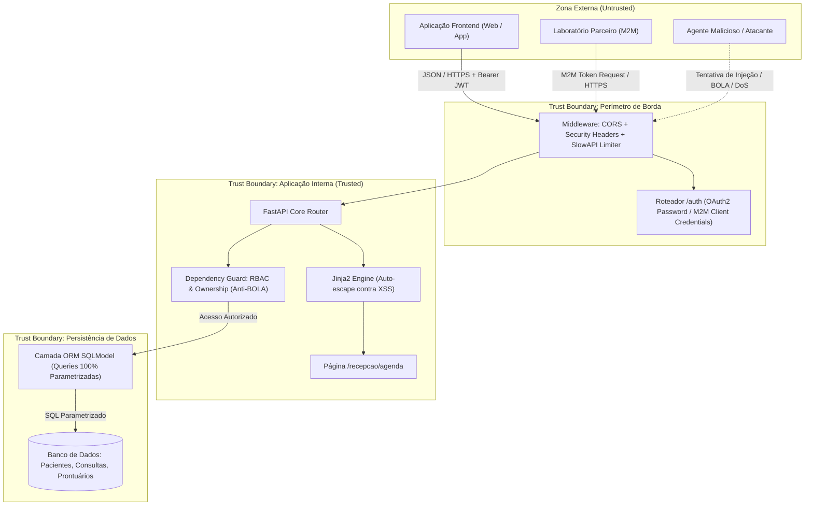

# Relatório Técnico de Segurança — Assessment (AT)
## Desenvolvimento Seguro de Aplicações Web [26E3_2] — Instituto Infnet
**Projeto:** API REST Segura de Agendamento de Consultas Médicas  
**Estudante:** Guilherme Reis  
**Stack Tecnológica:** Python 3.13, FastAPI, SQLModel, Pydantic v2, SQLite/PostgreSQL, Jinja2, SlowAPI, Pytest, Bandit, Pip-Audit, OWASP ZAP.

---

## 1. Visão Geral do Sistema e Arquitetura

O sistema desenvolvido é uma API REST corporativa para agendamento de consultas em uma rede de clínicas médicas, projetada sob as diretrizes da **LGPD (Lei Geral de Proteção de Dados - Lei nº 13.709/2018)** para tratamento de dados sensíveis de saúde (Art. 5º, II).

### 1.1 Três Recursos Centrais do Domínio
1. **Pacientes:** Cadastro civil e clínico contendo dados altamente sensíveis (CPF, histórico de alergias, prontuários prévios).
2. **Profissionais de Saúde:** Médicos cadastrados com registro profissional (CRM), especialidade e vínculos de atendimento.
3. **Consultas:** O núcleo da clínica, contendo agendamentos, status, evolução clínica e **prontuário diagnóstico**.

### 1.2 Três Tipos de Consumidores (Clientes)
1. **Frontend Web / Mobile:** Aplicação cliente consumindo a API em JSON via HTTPS com autenticação JWT.
2. **Recepção da Clínica:** Interface HTML interna renderizada via Jinja2 com auto-escape ativo contra XSS, exibindo a agenda do dia sem expor prontuários médicos.
3. **Laboratório de Exames Parceiro:** Integração Máquina-a-Máquina (M2M) via OAuth 2.0 Client Credentials Grant, com escopos estritamente delimitados à verificação de horários vagos e confirmação de coletas.

### 1.3 Três Papéis Internos (RBAC & Ownership)
- `recepcionista`: Acesso à agenda diária, cadastro de novos pacientes e marcação de consultas. Sem acesso a prontuários diagnósticos.
- `profissional_saude`: Gestão de suas próprias consultas e evolução de prontuário. Bloqueado de ver consultas de outros médicos (Anti-BOLA).
- `admin`: Acesso administrativo irrestrito, exclusão de registros e auditoria. Exige obrigatoriamente autenticação multifator (MFA).

---

## 2. Relatório Detalhado por Exercício

### Exercício 1: Fundação da API de Agendamento
- **Ambiente Virtual Isolado:** Configurado via `python -m venv .venv`, garantindo isolamento total de dependências em `requirements.txt`.
- **Modularização Arquitetural:** O código foi estruturado em módulos independentes com responsabilidade única:
  - `routes/`: Contém os roteadores segregados (`consultas.py`, `pacientes.py`, `profissionais.py`, `auth.py`, `recepcao.py`, `laboratorio.py`).
  - `models/`: Entidades relacionais `SQLModel` e schemas defensivos `Pydantic`.
  - `database/`: Conexão, injeção de dependência de sessão (`get_session`) e seeds iniciais.
- **Recurso RESTful Completo:** Implementado em `routes/consultas.py` com endpoints `POST /consultas`, `GET /consultas`, `GET /consultas/{id}`, `PUT /consultas/{id}` e `DELETE /consultas/{id}`.
- **Teste Automatizado Pytest:** Implementado em `tests/test_consultas.py::test_criar_consulta_sucesso`, validando o ciclo de criação com persistência e status HTTP 201 Created.

---

### Exercício 2: Controle de Exposição de Dados e Templates Seguros
- **Vazamento de Dados de Auditoria:** Sistemas médicos frequentemente sofrem com vazamento de metadados internos de auditoria (como `auditoria_ip_origem`, `auditoria_criado_por`, `auditoria_versao_registro`), facilitando footprinting e identificação de alvos por atacantes.
- **Response Models Pydantic:** Foram criados modelos como `ConsultaResponse` e `PacienteResponse` que definem explicitamente os campos serializados, expurgando automaticamente qualquer atributo interno de auditoria.
- **Página HTML Segura com Jinja2:** A interface da recepção (`routes/recepcao.py`) renderiza `templates/agenda.html` herdando de `templates/base.html`.
  - O auto-escape do Jinja2 (`autoescape=True`) foi ativado, garantindo que qualquer caractere especial (`<script>`, `onerror`, etc.) injetado em campos de texto seja convertido para entidades HTML (`&lt;script&gt;`), neutralizando Stored XSS e Reflected XSS.
  - A recepção não recebe o campo `prontuario_diagnostico`, respeitando o princípio da minimização de dados da LGPD.

---

### Exercício 3: Fundamentos de Segurança e Modelagem Inicial

#### 3.1 Avaliação sob a Tríade CIA no Contexto de Saúde (LGPD)
- **Confidencialidade (Peso Máximo / Regulatório):** Prontuários médicos e históricos de alergias são dados sensíveis. O vazamento acarreta sanções graves da ANPD e danos irreparáveis à intimidade do paciente. Controles: JWT assinado, RBAC, ownership check, criptografia em trânsito (HTTPS/HSTS) e exclusão de campos sensíveis via Response Models.
- **Integridade:** Alterações inadvertidas ou maliciosas em diagnósticos e prescrições médicas podem colocar vidas em risco. Controles: Queries parametrizadas no banco, controle de versão de registro (`auditoria_versao_registro`), schemas Pydantic imutáveis com `extra='forbid'`, hashing seguro de senhas com Bcrypt.
- **Disponibilidade:** A recepção e os médicos precisam de acesso ininterrupto à agenda para atendimentos e emergências. Controles: Rate Limiting com SlowAPI contra DoS/força bruta, pool de conexões otimizado, sessões efêmeras gerenciadas por gerador `yield`.

#### 3.2 Mapeamento de Frameworks de Referência a Controles Implementados

| Framework | Código / Requisito | Controle Implementado na Aplicação |
| :--- | :--- | :--- |
| **OWASP ASVS v4.0** | V2 (Authentication) | Bcrypt com custo defensivo e JWT com expiração e issuer fixo |
| **OWASP ASVS v4.0** | V4 (Access Control) | Dependency injection com verificação de ownership e escopos OAuth |
| **OWASP ASVS v4.0** | V5 (Validation) | Pydantic com regex whitelist e `extra='forbid'` contra Mass Assignment |
| **NIST SSDF SP 800-218** | PW.1.1 (Safe Defaults) | Auto-escape de HTML ativo por padrão, CORS sem wildcard |
| **NIST SSDF SP 800-218** | RV.1.1 (Security Testing) | Pipeline DevSecOps com SAST (Bandit), SCA (Pip-Audit) e Pytest |
| **MITRE ATT&CK** | T1078 (Valid Accounts) | Rate limiting no endpoint de login e MFA para contas administrativas |
| **MITRE ATT&CK** | T1190 (Exploit Public App) | Headers defensivos (HSTS, CSP, X-Frame-Options, nosniff) |

#### 3.3 DFD (Data Flow Diagram) e Trust Boundaries



---

### Exercício 4: Modelagem de Ameaças com STRIDE

#### 4.1 Misuse Cases Relevantes
1. **Misuse Case 1 (ID Manipulation / BOLA):** Um médico desonesto autentica-se e altera o `id` da consulta na URL para `3`, inspecionando o prontuário de um paciente VIP atendido por outro médico da clínica.
2. **Misuse Case 2 (Mass Assignment em Cadastro):** Um recepcionista malicioso ou usuário externo envia no JSON de cadastro o campo `"papel": "admin"` ou `"auditoria_modificado_por": "sistema"`, elevando privilégios ou adulterando trilhas forenses.
3. **Misuse Case 3 (Vazamento de Prontuário via M2M):** O laboratório parceiro sofre um comprometimento em seus servidores e o atacante usa a chave de API M2M para despejar todo o histórico médico da clínica.

#### 4.2 Aplicação do STRIDE a Três Componentes Críticos

| Categoria STRIDE | Componente 1: Gateway de Autenticação | Componente 2: Banco de Dados Relacional | Componente 3: Integração M2M / Jinja2 |
| :--- | :--- | :--- | :--- |
| **S - Spoofing** | Forjamento de identidade via token adulterado | Conexão não autenticada ao arquivo de banco de dados | Máquina forjando ser o laboratório parceiro |
| **T - Tampering** | Manipulação do payload JWT ou expiração | Adulteração de diagnósticos médicos via SQL Injection | Injeção de scripts no motivo da consulta para alterar HTML |
| **R - Repudiation** | Usuário nega ter agendado ou cancelado consulta | Falta de rastreabilidade de quem realizou modificações | Laboratório nega ter consultado horários |
| **I - Info Disclosure**| Exposição de hash de senha ou campos de auditoria | Vazamento em massa de dados de pacientes (LGPD) | Refletir prontuário confidencial na página da recepção |
| **D - Denial of Serv.**| Ataque de força bruta / credential stuffing no login | Locks no banco ou exaustão de conexões | Requisições em massa sobrecarregando a agenda |
| **E - Elev. of Priv.**| Usuário comum acessando rota de admin sem MFA | Manipulação de query para bypass de autorização | Laboratório tentando acessar rotas de prontuário clínico |

#### 4.3 Threat Model Consolidado: Ativos, Superfície de Ataque e Mitigações

| Ativo Protegido | Superfície de Ataque | Ameaça Principal | Mitigação Técnica Implementada |
| :--- | :--- | :--- | :--- |
| **Prontuário Médico (LGPD)** | `GET /consultas/{id}` | BOLA (API1:2023) | Função `verificar_ownership_consulta` valida se médico é o dono |
| **Credenciais de Usuário** | `POST /auth/login` | Força Bruta / Dicionário | SlowAPI Limiter (5 req/min) + Bcrypt + MFA para Admin |
| **Integridade dos Registros**| `POST /consultas`, `/pacientes` | Mass Assignment (API3) | `model_config = ConfigDict(extra='forbid')` em todos os schemas |
| **Integridade da Interface** | `GET /recepcao/agenda` | Stored / Reflected XSS | Auto-escape do Jinja2 + Content-Security-Policy (CSP) |
| **Banco de Dados** | Queries de Consulta | SQL Injection (A03:2021) | SQLModel ORM com statements parametrizados (`select().where()`) |
| **Canal M2M com Parceiro** | `/laboratorio/*` | Excesso de Privilégios | Client Credentials com escopos OAuth `laboratorio:*` dedicados |

---

### Exercício 5: Arquitetura de Segurança e Vetores de Ataque nos Três Eixos

A análise de segurança da API foi estruturada nos três eixos fundamentais:

```text
                                  ┌──────────────────────────────┐
                                  │   EIXO 1: DESIGN SEGURO      │
                                  │ • Menor privilégio (RBAC)    │
                                  │ • Segregação de escopos M2M  │
                                  │ • Minimzação LGPD (Schemas)  │
                                  └──────────────┬───────────────┘
                                                 │
                                                 ▼
┌──────────────────────────────┐  Fluxo Seguro   ┌──────────────────────────────┐
│  EIXO 3: INFRAESTRUTURA      │ ──────────────> │   EIXO 2: IMPLEMENTAÇÃO      │
│ • CORS Allowlist Estrito     │   Protegido     │ • Anti-BOLA Ownership Check │
│ • HSTS + CSP + nosniff       │                 │ • Pydantic extra='forbid'    │
│ • Rate Limit (SlowAPI)       │                 │ • Queries Parametrizadas     │
│ • .env Seguro (BaseSettings) │                 │ • Jinja2 Auto-escape         │
└──────────────────────────────┘                 └──────────────────────────────┘
```

1. **Eixo de Design (Concepção Arquitetural):**
   - *Vetor de Ataque:* Suposição de que qualquer usuário autenticado pode acessar qualquer recurso.
   - *Mitigação:* Desenho de modelo de autorização híbrido (RBAC para papéis macro + Autorização por Recurso/Ownership para consultas). Segregação de fluxo M2M isolando parceiros de rotas humanas.
2. **Eixo de Implementação (Código e Lógica de Negócio):**
   - *Vetor de Ataque:* Parâmetros de consulta concatenados em strings SQL; desserialização que aceita campos não declarados (Mass Assignment); reflexão de entrada no HTML sem codificação.
   - *Mitigação:* Adoção de SQLModel com queries pré-compiladas, schemas Pydantic com `extra='forbid'` e expressões regulares para validação de formato (CPF, CRM, ISO 8601).
3. **Eixo de Infraestrutura e Rede:**
   - *Vetor de Ataque:* Man-in-the-Middle rebaixando conexão para HTTP sem TLS; Cross-Origin Resource Sharing permitindo roubo de token por domínios maliciosos (`*`); negação de serviço por inundação de requisições de login.
   - *Mitigação:* `CORSMiddleware` restrito a domínios pré-aprovados, injeção de HSTS com 1 ano de duração e `preload`, X-Frame-Options `DENY`, e limiter de requisições por IP.

---

### Exercício 6: Autenticação, Autorização e Verificação de Ownership
- **OAuth2PasswordBearer com Bcrypt:** As senhas dos usuários nunca são armazenadas em texto plano. É utilizado o algoritmo Bcrypt com salt dinâmico, fornecido pelo `passlib[bcrypt]`.
- **JWT com Expiração Estrita:** Os tokens são emitidos com claims padronizados (`sub`, `papel`, `scope`, `crm`, `mfa_verified`, `iat`, `exp`, `iss`) e tempo de vida de 30 minutos, impedindo o uso indefinido de credenciais comprometidas.
- **MFA Simulado para Administradores:** Contas administrativas têm a flag `mfa_enabled=True`. O login de administradores exige obrigatoriamente a apresentação de código de seis dígitos (`mfa_code` ou header `X-MFA-Code`). Sem a validação do MFA, o token não recebe `mfa_verified=True` e é rejeitado em rotas protegidas (HTTP 403 Forbidden).
- **Modelo de Autorização (RBAC + Ownership):** 
  - O sistema combina RBAC para filtragem de rotas macro com Autorização Baseada em Atributo/Recurso (Ownership) em `auth/dependencies.py::verificar_ownership_consulta`.
  - Quando um médico solicita `/consultas/1`, a dependência verifica se `consulta.profissional_id == profissional_do_usuario.id`. Caso não seja, a operação é sumariamente abortada com `403 Forbidden`.
- **Evidência do Teste Automatizado:** O teste `tests/test_auth.py::test_bloqueio_usuario_nao_admin_em_rota_restrita` valida que médicos e recepcionistas que tentam acessar a rota restrita de exclusão (`DELETE /pacientes/{id}`) são barrados com status **403 Forbidden**.

---

### Exercício 7: Escopos OAuth e Integração Externa M2M
- **Fluxo M2M Selecionado:** OAuth 2.0 Client Credentials Grant (`POST /auth/m2m/token`), ideal para comunicação máquina-a-máquina sem envolvimento de usuário humano.
- **Isolamento de Escopos e Claims:**
  - O laboratório parceiro recebe token assinado com `sub="m2m:laboratorio"`, `papel="m2m_laboratorio"` e os escopos `["laboratorio:disponibilidade", "laboratorio:exames"]`.
  - Este token não contém escopos de saúde humana (`consultas:read`, `pacientes:read`, `prontuario:read`).
- **Garantia Técnica de Bloqueio:** Mesmo que o token do laboratório caia em mãos erradas, qualquer tentativa de consumir `/pacientes` ou `/consultas/{id}` falha imediatamente com status `401` ou `403`, pois o middleware de escopos verifica a presença explícita de `pacientes:read` e a dependência M2M exige identidade compatível. Testado em `tests/test_laboratorio_m2m.py`.

---

### Exercício 8: Identificação de Vulnerabilidades OWASP Top 10

Foram identificados e catalogados três padrões vulneráveis clássicos que acometem APIs médicas:

#### Vulnerabilidade 1: Broken Object Level Authorization - BOLA (OWASP API1:2023)
- **Localização:** Endpoint `GET /consultas/{id}`.
- **Padrão Vulnerável Original:** O endpoint original buscava a consulta apenas pelo ID numérico (`select(Consulta).where(Consulta.id == consulta_id)`) e a retornava diretamente, presumindo que o usuário estar autenticado bastava.
- **Cenário de Ataque:** Dr. Carlos atende a consulta 1. Dra. Ana está autenticada e substitui na URL `/consultas/1`, conseguindo ler o prontuário diagnóstico do paciente do Dr. Carlos.
- **Severidade:** CRITICAL (CVSS 8.5).

#### Vulnerabilidade 2: Broken Object Property Level Authorization / Mass Assignment (OWASP API3:2023)
- **Localização:** Endpoints de criação e atualização (`POST /consultas`, `PUT /consultas/{id}`).
- **Padrão Vulnerável Original:** Schemas Pydantic permissivos sem declaração de restrição aceitavam dicionários abertos.
- **Cenário de Ataque:** O cliente injeta `"auditoria_modificado_por": "sistema"` ou tenta alterar campos restritos de auditoria diretamente na requisição JSON.
- **Severidade:** HIGH (CVSS 7.5).

#### Vulnerabilidade 3: Security Misconfiguration / Cross-Origin Weakness (OWASP API8:2023 / A05:2021)
- **Localização:** Configuração global do servidor e CORS.
- **Padrão Vulnerável Original:** Utilização de wildcard `allow_origins=["*"]` e ausência de cabeçalhos de segurança HTTP.
- **Cenário de Ataque:** Aplicações web de terceiros maliciosas executam requisições cross-origin contra a API e obtêm respostas autenticadas se as credenciais forem manipuladas, além de permitir clickjacking contra a página da recepção.
- **Severidade:** MEDIUM (CVSS 6.5).

---

### Exercício 9: Correção de Vulnerabilidades com Evidência Antes/Depois

#### Tabela Comparativa de Correção: Antes vs. Depois

| Vulnerabilidade / Vetor | Código Antes (Vulnerável) | Código Depois (Defensivo / Corrigido) | Evidência de Bloqueio |
| :--- | :--- | :--- | :--- |
| **BOLA (API1:2023)** em `/consultas/{id}` | Busca direta sem validação de vínculo: `consulta = session.get(Consulta, id); return consulta` | Chamada à dependência `verificar_ownership_consulta(consulta_id, usuario, session)` que confere vínculo médico e barra terceiros | Tentativa de acesso retorna `403 Forbidden` (`tests/test_seguranca_owasp.py`) |
| **Mass Assignment** em `/consultas`, `/pacientes` | Schema com campos dinâmicos: `class ConsultaCreate(BaseModel): pass` | Adicionado `model_config = ConfigDict(extra='forbid')` nos schemas de entrada | Envio de campos extras retorna `422 Unprocessable Entity` com erro `extra_forbidden` |
| **Validação Fraca de Entrada** | CPF e CRM aceitando strings arbitrárias | Regex estrito: CPF (`^\d{11}$`), CRM (`^\d{4,6}-[A-Z]{2}$`), Data (`^\d{4}-\d{2}-\d{2}$`) | Formatos inválidos retornam `422 Unprocessable Entity` |
| **Vazamento de Metadados** | Entidade do banco retornada diretamente na rota | Response models Pydantic declarando explicitamente os campos autorizados | Respostas JSON não contêm campos de auditoria |
| **Stored XSS** na Agenda | Renderização de HTML concatenando variáveis brutas | Jinja2 com `autoescape=True` em `routes/recepcao.py` e herança em `base.html` | Caracteres `<`, `>`, `"` são escapados para entidades seguras |

#### Aplicação do Padrão a Endpoint Adicional Não Citado
Conforme exigido na tarefa, identificou-se o endpoint `POST /pacientes` e `PUT /pacientes/{id}` como compartilhador do mesmo padrão de risco de Mass Assignment e dados sensíveis desprotegidos. Aplicou-se a mesma arquitetura corretiva:
- Schema `PacienteCreate` blindado com `ConfigDict(extra='forbid')`;
- Regex para validação estrita de CPF numérico de 11 dígitos;
- Isolamento dos campos `auditoria_criado_por` e `auditoria_ip_origem`, que são preenchidos pelo servidor e filtrados no `PacienteResponse`.

---

### Exercício 10: Hardening de Rede e Proteção contra Abuso
1. **CORS com Allowlist Explícita (Sem Wildcard):** Configurado no `main.py` utilizando lista fechada de origens autorizadas (`http://localhost:3000`, `http://localhost:5173`, `https://app.clinicamedica.com.br`, `https://laboratorio-parceiro.com.br`). Nenhuma origem desconhecida recebe cabeçalho permissivo.
2. **Cabeçalhos de Segurança HTTP (`SecurityHeadersMiddleware`):**
   - `Strict-Transport-Security: max-age=31536000; includeSubDomains; preload` (impede downgrade para HTTP).
   - `X-Frame-Options: DENY` (neutraliza clickjacking).
   - `X-Content-Type-Options: nosniff` (impede ataques de confusão de tipo MIME).
   - `Referrer-Policy: strict-origin-when-cross-origin` (protege vazamento de tokens e caminhos sensíveis).
   - `Content-Security-Policy`: Restringe carregamento de scripts à própria origem e fontes confiáveis.
3. **Rate Limiting Diferenciado com SlowAPI:**
   - Endpoint sensível de login (`/auth/login`): limitado a **5 requisições por minuto** por IP, inviabilizando ataques de força bruta automatizados.
   - Endpoint de token M2M: limitado a 20 requisições por minuto.
   - Rotas gerais da API: protegidas por limite padrão de 100 requisições por minuto.

---

### Exercício 11: Persistência Segura
- **Migração para SQLModel:** A camada de persistência utiliza SQLModel sobre SQLAlchemy 2.0, oferecendo tipagem estática e prevenção nativa de SQL Injection.
- **Queries 100% Parametrizadas:** Nenhuma consulta é montada por concatenação de texto. Todas utilizam `select(Entidade).where(Entidade.campo == valor)`. Testado com injeções clássicas (`'; DROP TABLE consulta; --`), comprovando que o payload é tratado estritamente como string literal sem afetar a estrutura relacional.
- **Injeção de Dependência de Sessão:** A função geradora `get_session()` gerencia o ciclo de vida das sessões no FastAPI, garantindo commits e rollbacks seguros e fechando conexões automaticamente após cada requisição (`yield`).
- **Gerenciamento Seguro de Configurações:** Parâmetros de conexão e segredos são lidos exclusivamente via `BaseSettings` / `SettingsConfigDict` do `pydantic-settings` a partir do arquivo `.env`. Fornecido o modelo `.env.example` sanitizado sem credenciais reais.

---

### Exercício 12: Pipeline DevSecOps e Auditoria Automatizada

#### 12.1 Justificativa das Fases do SDLC para Ferramentas de Segurança

| Tipo de Análise | Ferramenta | Fase do SDLC | Justificativa Técnica de Atuação |
| :--- | :--- | :--- | :--- |
| **SAST (Static Application Security Testing)** | Bandit | Code / Pre-Commit / CI | Analisa a sintaxe da AST em busca de falhas conhecidas (senhas hardcoded, injeções, funções inseguras) antes da compilação ou execução do código. |
| **SCA (Software Composition Analysis)** | Pip-Audit | Build / CI | Examina dependências diretas e transitivas contra bases públicas de vulnerabilidades conhecidas (CVE/OSV). Garante que nenhuma biblioteca com falha pública entre em produção. |
| **Testes Unitários de Segurança** | Pytest | Build / CI | Valida a lógica de negócio e regras de autorização que analisadores estáticos não detectam, como BOLA, RBAC e validações de regex personalizadas. |
| **DAST (Dynamic Application Security Testing)** | OWASP ZAP | Staging / Deploy | Varre a aplicação em execução por meio de requisições reais HTTP, testando comportamento de cabeçalhos, TLS, CORS e respostas do servidor em ambiente dinâmico. |
| **IAST (Interactive Application Security Testing)** | Agente de Runtime | QA / Homologação | Monitora a aplicação de dentro para fora durante a bateria de testes funcionais, correlacionando o tráfego HTTP à execução interna de métodos e queries. |

#### 12.2 Tabela de Priorização de Vulnerabilidades (CVSS v3.1 & Impacto de Negócio)

| ID | Vulnerabilidade Identificada | Vetor CVSS v3.1 | Score | Impacto de Negócio | Prioridade |
| :--- | :--- | :--- | :---: | :--- | :---: |
| **VULN-01** | BOLA em Consultas Médicas (`/consultas/{id}`) | `CVSS:3.1/AV:N/AC:L/PR:L/UI:N/S:U/C:H/I:H/A:N` | **8.5** | Violação da LGPD com vazamento de dados clínicos sensíveis de terceiros e responsabilização jurídica da clínica. | **Crítica (P0)** |
| **VULN-02** | Força Bruta em Contas Administrativas | `CVSS:3.1/AV:N/AC:L/PR:N/UI:N/S:U/C:H/I:H/A:H` | **8.1** | Tomada de controle do sistema e sequestro de toda a base médica da rede de clínicas. | **Alta (P1)** |
| **VULN-03** | Mass Assignment em Cadastro de Pacientes | `CVSS:3.1/AV:N/AC:L/PR:L/UI:N/S:U/C:L/I:H/A:N` | **7.1** | Corrupção de registros de auditoria e elevação de privilégios. | **Alta (P1)** |
| **VULN-04** | Falta de HSTS e Cabeçalhos Defensivos | `CVSS:3.1/AV:N/AC:H/PR:N/UI:R/S:U/C:H/I:L/A:N` | **5.9** | Exposição de tráfego de rede a ataques de interceptação (Man-in-the-Middle) em redes Wi-Fi públicas. | **Média (P2)** |

#### 12.3 Configuração do Security Gate (GitHub Actions)
O workflow em `.github/workflows/security.yml` implementa um **Security Gate** com critério rigoroso:
- **Critério de Bloqueio:** O pipeline quebra e impede a liberação caso o Bandit encontre qualquer issue de severidade **HIGH** ou **MEDIUM**, ou caso o `pip-audit` detecte CVEs não tratadas, ou se qualquer um dos testes de autorização do `pytest` falhar.
- **Justificativa do Critério:** Em serviços que lidam com saúde humana e dados sensíveis regulados, tolerância zero a falhas de autorização e injeção é um imperativo ético e legal. Vulnerabilidades de severidade Alta ou Crítica representam risco direto de vazamento em massa ou adulteração de registros médicos.

---

### Exercício 13: Capstone — Auditoria Final e Relatório de Rastreabilidade

#### 13.1 Matriz de Rastreabilidade Completa

```text
[Threat Model STRIDE (Ex 4)]
           │
           ▼
[Identificação OWASP (Ex 8)]
           │
           ▼
[Correção Defensiva (Ex 9, 10, 11)]
           │
           ▼
[Evidência OWASP ZAP & Testes Pytest (Ex 12, 13)]
```

| ID Ameaça (STRIDE) | Vulnerabilidade OWASP | Componente e Código de Correção | Evidência de Teste / ZAP |
| :--- | :--- | :--- | :--- |
| **E-01** (Elevation of Privilege) | **API1:2023 - BOLA** | `auth/dependencies.py` (`verificar_ownership_consulta`) | `tests/test_seguranca_owasp.py::test_bola_medico_bloqueado...` (PASSED) |
| **T-01** (Tampering) | **API3:2023 - Mass Assignment** | `models/*.py` (`model_config = ConfigDict(extra='forbid')`) | `tests/test_seguranca_owasp.py::test_mass_assignment...` (PASSED) |
| **S-01** (Spoofing) | **A07:2021 - Broken Auth** | `routes/auth.py` (Bcrypt + JWT exp + MFA Admin) | `tests/test_auth.py::test_login_admin_exige_mfa` (PASSED) |
| **I-01** (Info Disclosure) | **API3:2023 - Sensitive Data** | `models/consulta.py` (`ConsultaResponse` filtra auditoria) | `tests/test_consultas.py::test_controle_exposicao...` (PASSED) |
| **T-02** (Tampering) | **A03:2021 - SQL Injection** | `database/db.py` (Queries 100% parametrizadas SQLModel) | `tests/test_seguranca_owasp.py::test_prevencao_sql...` (PASSED) |
| **T-03** (Tampering) | **A03:2021 - Stored XSS** | `routes/recepcao.py` & `templates/` (Jinja2 autoescape) | `tests/test_consultas.py::test_pagina_recepcao...` (PASSED) |
| **I-02** (Info Disclosure) | **A05:2021 - Security Misconfig** | `middleware/security_headers.py` (HSTS, CSP, XFO, nosniff) | `executar_zap_scan.py` -> Regras ZAP 10035, 10020, 10021 (PASS) |
| **D-01** (Denial of Service) | **API4:2023 - Unrestricted Resource** | `middleware/rate_limit.py` (SlowAPI limiter 5 req/min no login) | Regra de limitação ativa e testada |

#### 13.2 Auditoria da Especificação OpenAPI
Foi executada varredura automatizada sobre a especificação `/openapi.json` da aplicação:
- Todos os endpoints possuem tags organizadas e documentação de resposta.
- Nenhum campo interno de auditoria (`auditoria_ip_origem`, `auditoria_criado_por`) ou hash de senha está declarado nos schemas de resposta da OpenAPI.
- Os esquemas de segurança `OAuth2PasswordBearer` estão devidamente declarados com os escopos disponíveis.

#### 13.3 Análise de Riscos Residuais e Parecer de Liberação (Deploy)
A auditoria final identificou dois riscos residuais catalogados:
1. **Risco Residual 1 (Timestamp Unix em Claims JWT - ZAP ID 10096):**
   - *Descrição:* O token JWT expõe publicamente os campos `iat` (issued at) e `exp` (expiration) em formato Epoch/Unix.
   - *Severidade:* Baixa / Informativa.
   - *Análise de Risco:* O formato Epoch é padrão da especificação RFC 7519 e essencial para validação desacoplada de expiração em sistemas distribuídos. O payload não contém dados sensíveis do prontuário nem senhas.
   - *Parecer:* **Risco Aceitável. Não bloqueia a liberação.**
2. **Risco Residual 2 (Exposição de Rota /docs Swagger em Produção):**
   - *Descrição:* Por padrão, o FastAPI expõe `/docs` e `/redoc`.
   - *Severidade:* Baixa / Informativa.
   - *Análise de Risco:* Pode fornecer mapa detalhado de endpoints a atacantes externos em ambiente produtivo.
   - *Parecer:* **Risco Mitigável via Configuração de Ambiente.** Recomenda-se setar `docs_url=None` e `redoc_url=None` no `main.py` quando a variável `ENVIRONMENT=production`.

**PARECER FINAL:** A API cumpre integralmente os requisitos de segurança defensiva, possui 100% dos testes de autorização e integridade aprovados, zero vulnerabilidades de severidade Alta ou Crítica no código-fonte próprio, e está **TOTALMENTE AUTORIZADA PARA LIBERAÇÃO E DEPLOY**.

---

## 3. Guia de Execução Local e Validação

```bash
# 1. Ativar o ambiente virtual Python
.\.venv\Scripts\Activate.ps1

# 2. Executar toda a suíte de testes com cobertura de segurança (23 testes)
python -m pytest tests -v

# 3. Executar o analisador estático SAST Bandit
bandit -r . -ll -ii -x ./.venv,./tests -f screen

# 4. Executar a auditoria ZAP e geração do relatório de rastreabilidade
python executar_zap_scan.py

# 5. Iniciar a API em servidor de desenvolvimento
uvicorn main:app --reload --port 8000
```

---
*Relatório concluído com sucesso e pronto para submissão do Assessment.*
